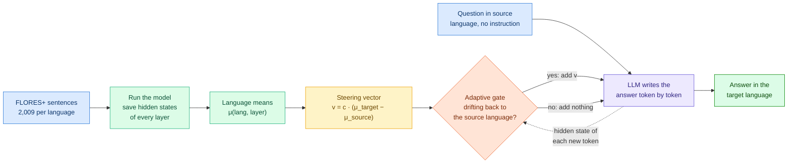
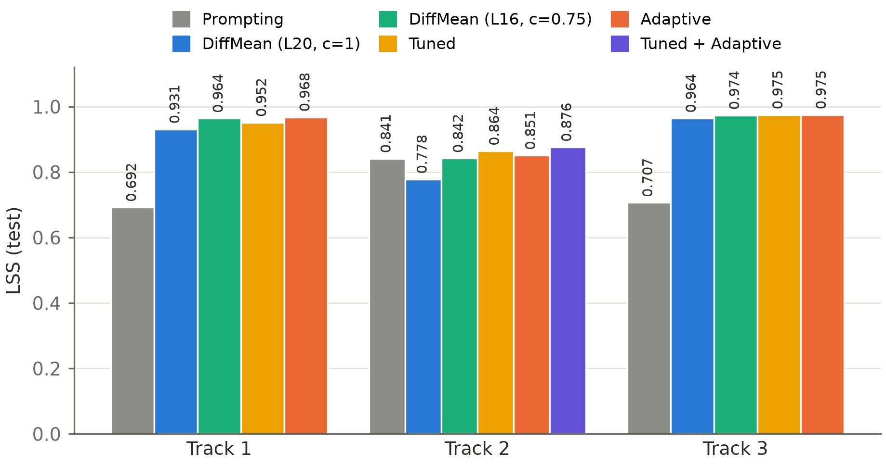
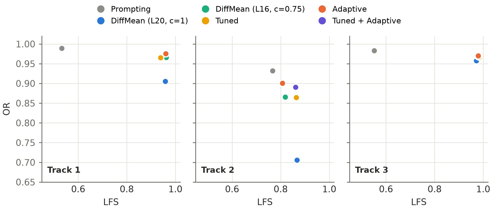
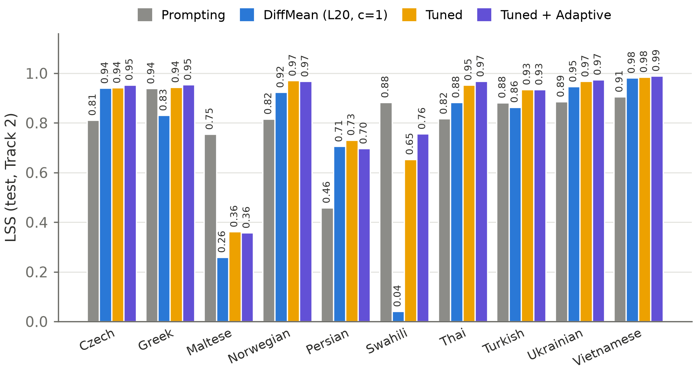
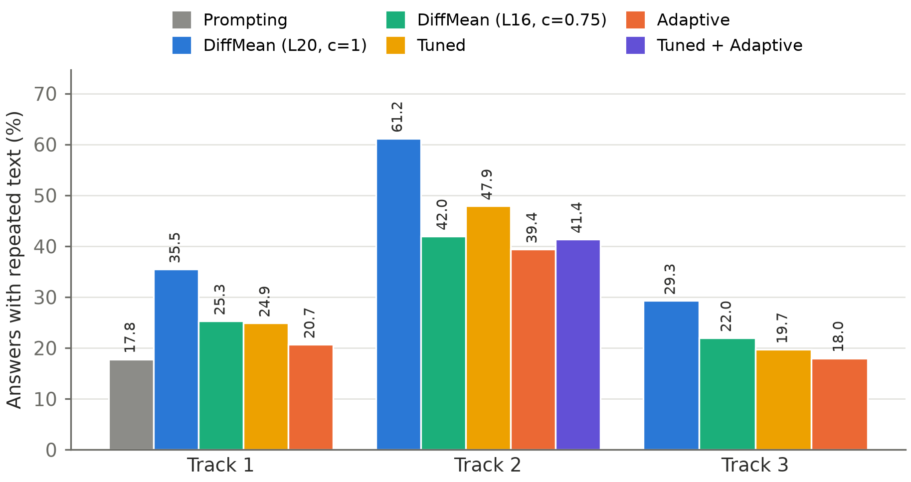
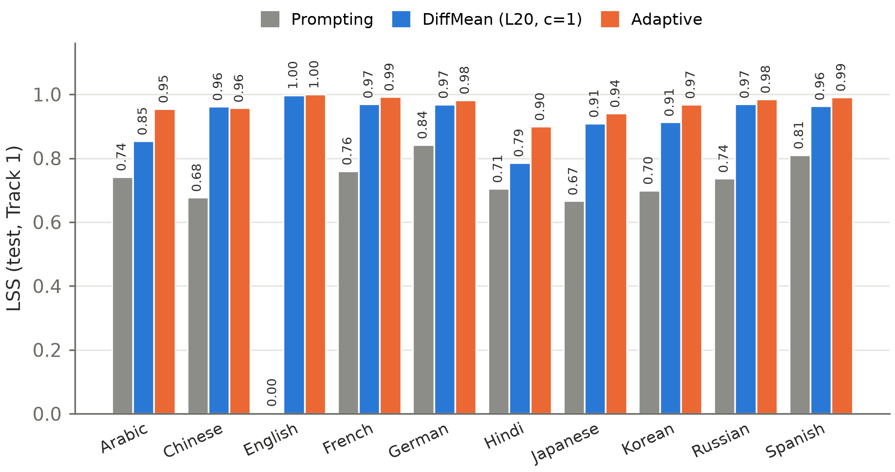
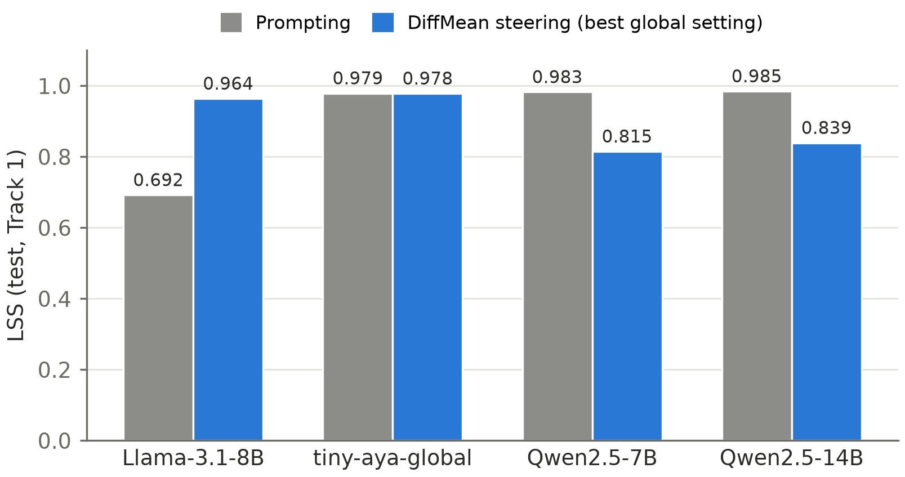

<div align="center">

# 🧭 Adaptive Activation Steering for Cross-Lingual Response Control in LLMs

**Make a language model answer in the language you choose, by editing its hidden states while it writes, with no retraining and no prompt instruction.**

[](https://clas-semeval2027.github.io/clas.semeval2027/task/)
[](#-the-task)
[](#-four-models-when-does-steering-help)
[](#-method)


**Team Neural-Ninja** · Monirul Islam Mahmud · Sai Chaithrik Dangeti · Santoshsujith Chavva
<br>CS 5134/6034 Natural Language Processing, University of Cincinnati, Fall 2026

</div>

---

## ✨ Highlights

| | |
|---|---|
| 🚀 **+0.276 LSS over prompting** | On Llama-3.1-8B (Track 1), adaptive steering reaches **0.968** LSS, while the official prompting baseline reaches **0.692**. |
| 🌍 **Low-resource languages fixed** | One global steering setting breaks Swahili (LSS **0.04**). Per-language tuning plus adaptive steering lifts it to **0.76** and Track 2 to **0.876**, the best Track 2 result. |
| 🎯 **~90% fewer interventions** | The adaptive gate adds the steering vector to only **7 to 13%** of answer tokens, yet matches or beats steering every token. |
| 🔁 **Less looping text** | Track 2 answers that repeat themselves drop from **61.2%** to **39.4%**. |
| 📏 **Checked properly** | Validation and test are separate, a fair control isolates each idea, a paired bootstrap tests every claim, and two human raters audit the judge. |
| 🔍 **Found a flaw in the metric** | The Qwen3-8B judge gave the top score to **all 100** sampled Hindi answers, including the 13 that both humans marked as broken loops. |

---

## 📌 The task

[SemEval-2027 Task 7 (CLaS)](https://clas-semeval2027.github.io/clas.semeval2027/task/): a user asks a question in a **source** language, and the model must answer in a **target** language. The language must be controlled from **inside** the model at inference time. A language instruction in the prompt does not count as a steering method.

| Track | Pairs | Languages |
|---|---|---|
| **Track 1** · high resource | 90 | ar, de, en, es, fr, ja, zh, ru, **hi**, ko (all cross pairs) |
| **Track 2** · low resource | 100 | same 10 sources → cs, el, fa, vi, uk, mt, no, sw, th, tr |
| **Track 3** · many to one | 19 | all 20 languages → German |

**Metric.** LSS is the harmonic mean of **LFS** (share of answers that fastText labels as the target language with confidence ≥ 0.9) and **OR** (relevance and coherence from a Qwen3-8B judge, 0/1/2 scaled to 0 to 1). LSS is low if either the language or the content fails.

### 🗣️ A real example (Llama-3.1-8B, test set)

| | Input | Output |
|---|---|---|
| **Prompting** | `كيف يمكنني تحسين مهارات إدارة الوقت؟` + *"Respond in English."* | `تحسين مهارات إدارة الوقت يتطلب بعض الاستراتيجيات والتقنيات...` ❌ still Arabic |
| **Steering** (no instruction) | `كيف يمكنني تحسين مهارات إدارة الوقت؟` + English vector | `There are several ways to improve your time management skills. Here are some tips: 1. **Set clear goals**...` ✅ English |
| **Steering** (no instruction) | `मैं अपने समय प्रबंधन कौशल को कैसे सुधार सकता हूँ?` + German vector | `Zeitmanagement, oder Zeitplanung, ist ein wichtige Fähigkeit, die es dir ermöglicht, deine Zeit effizient zu nutzen... Hier sind einige Tipps, um deine Zeitmanagement-Fähigkeit zu verbessern...` ✅ German |

With the instruction alone, Llama ignored it in **26 to 45%** of cases per target language, and in **99%** of cases when the target was English. Steering fixes this language confusion.

---

## 🛠️ Method



**1. DiffMean steering (baseline).** For each language we average the hidden states of its FLORES+ sentences at every layer. The steering vector is the target mean minus the source mean, scaled by a strength $c$, and is added to one decoder layer at every token:

$$h_\ell \leftarrow h_\ell + c\,(\mu_{\text{target},\ell} - \mu_{\text{source},\ell})$$

**2. Tuned steering (Idea 1).** Instead of one layer and strength for every language, we pick them **per target language** on the validation questions, and keep the global setting unless a language gains at least 0.02 LSS.

**3. Adaptive steering (Idea 2).** The question and the first 32 answer tokens are always steered. After that, a running average $\bar h_t$ of the hidden state is compared with the target and source language means (centred on the mean of all 20 languages). The vector is added **only when the answer drifts toward the source language**:

$$\text{steer at step } t \iff \cos(\bar h_t-\bar\mu,\ \mu_s-\bar\mu) > \cos(\bar h_t-\bar\mu,\ \mu_t-\bar\mu)$$

This classifier needs **no training**: it reuses the language means already computed for the steering vectors.

### 💡 What is new here

- 🧠 **Closed-loop, training-free gating.** The gate reads the model's own hidden state and reuses the steering statistics, so it adds no new parameters and no training data.
- 🎚️ **Per-language calibration** of layer and strength, which matters most for low-resource targets (Greek validation LSS 0.63 → 0.94, Persian 0.59 → 0.78).
- 🧪 **A fair control.** Every gain is measured against fixed steering at the same layer and strength, with a paired bootstrap.
- 🔎 **An audit of the official judge** with two independent Hindi raters.
- 📊 **A cross-model view.** The same method on four LLMs shows *when* steering is worth using.

---

## 📈 Results

All numbers are on our held-out **test** split (50 questions per language, never used to choose any setting).

### Main results, Llama-3.1-8B-Instruct (test LSS)

| Method | Track 1 | Track 2 | Track 3 |
|---|:---:|:---:|:---:|
| No instruction | 0.000 | – | – |
| Prompting (reference, not steering) | 0.692 | 0.841 | 0.707 |
| DiffMean, layer 20, c = 1 | 0.931 | 0.778 | 0.964 |
| DiffMean, layer 16, c = 0.75 | 0.964 | 0.842 | 0.974 |
| Tuned per language | 0.952 | 0.864 | **0.975** |
| **Adaptive** | **0.968** 🥇 | 0.851 | **0.975** 🥇 |
| **Tuned + Adaptive** | – | **0.876** 🥇 | – |

<p align="center"></p>

### Language and quality together

Prompting keeps quality but often answers in the wrong language. Steering moves the answers into the target language, and the adaptive gate wins back answer quality.

<p align="center"></p>

### 🌍 Low-resource languages (Track 2)

<p align="center"></p>

| Target | DiffMean (L20, c=1) | Tuned + Adaptive | Change |
|---|:---:|:---:|:---:|
| Swahili | 0.04 | **0.76** | 🔼 +0.72 |
| Greek | 0.83 | **0.95** | 🔼 +0.12 |
| Thai | 0.88 | **0.97** | 🔼 +0.09 |
| Turkish | 0.86 | **0.93** | 🔼 +0.07 |
| Maltese | 0.26 | **0.36** | 🔼 +0.10 |

### 🔁 Less broken, looping text

<p align="center"></p>

### Per target language, Track 1

<p align="center"></p>

### 🤖 Four models: when does steering help?

| Model | Prompting | DiffMean steering |
|---|:---:|:---:|
| **Llama-3.1-8B-Instruct** | 0.692 | **0.964** 🔼 |
| tiny-aya-global | 0.979 | 0.978 |
| Qwen2.5-7B-Instruct | 0.983 | 0.815 |
| Qwen2.5-14B-Instruct | 0.985 | 0.839 |

<p align="center"></p>

**Steering pays off most when a model ignores language instructions.** Llama follows "Respond in X" only about half the time, and steering lifts it by +0.27. Models that already follow the instruction (tiny-aya, Qwen) leave little room to gain.

### 📏 Statistical significance

Paired bootstrap over language pairs, 10,000 resamples, 95% confidence interval. Full table: [`results/significance.md`](results/significance.md).

| Track | Comparison | ΔLSS | 95% CI | Significant |
|---|---|:---:|:---:|:---:|
| 1 | DiffMean vs prompting | +0.239 | [+0.187, +0.299] | ✅ |
| 3 | DiffMean vs prompting | +0.258 | [+0.174, +0.356] | ✅ |
| 2 | Tuned vs DiffMean (L20, c=1) | +0.086 | [+0.063, +0.112] | ✅ |
| 2 | Tuned vs DiffMean (L16, c=0.75) | +0.022 | [+0.011, +0.036] | ✅ |
| 2 | Adaptive vs DiffMean (same layer and strength) | +0.009 | [+0.001, +0.020] | ✅ |
| 2 | Tuned + Adaptive vs Tuned | +0.012 | [+0.005, +0.018] | ✅ |
| 1 | Adaptive vs DiffMean (same layer and strength) | +0.004 | [−0.000, +0.008] | ≈ equal, with ~90% fewer interventions |

### 🔍 Human check of the judge (Hindi)

Two Hindi-speaking teammates rated 100 random Hindi answers with the judge's own 0/1/2 guide, each without seeing the other's scores.

| Comparison | Exact agreement | Cohen's κ | OR |
|---|:---:|:---:|:---:|
| Rater 1 vs Rater 2 | **93%** | **0.858** | 0.790 / 0.755 |
| Humans vs Qwen3-8B judge | 71% | 0.00 | 0.77 / **1.00** |

The two humans agree strongly, but the judge gave **2 to every answer**, including the 13 that both humans rated 0 for looping. The official OR therefore **overestimates** answer quality by about 0.23 for Hindi. This is useful for anyone using LLM judges to score steered text.

---

## 🗂️ Data

| Split | Source | Size | Used for |
|---|---|---|---|
| Train | [FLORES+](https://huggingface.co/datasets/openlanguagedata/flores_plus) dev + devtest | 2,009 sentences × 20 languages | building steering vectors only |
| Validation | [CLaS-Bench](https://huggingface.co/datasets/DGurgurov/CLaS-Bench), 20 questions | 20 × 20 languages | choosing every layer, strength and gate setting |
| Test | CLaS-Bench, the other 50 questions | 50 × 20 languages | reporting results only |

The split is made by question ID (seed 2027, [`splits/split.json`](splits/split.json)), so no question appears in both sets in any language. The official SemEval test set is hidden and was not used.

---

## ⚙️ Reproduce

<details>
<summary><b>Setup on a Slurm cluster</b></summary>

```bash
bash scripts/setup_cluster.sh
source ~/.bashrc && clas
bash scripts/download_all.sh
bash scripts/download_extra_models.sh
python scripts/make_splits.py
```
</details>

<details>
<summary><b>Run the experiments</b></summary>

```bash
sbatch slurm/extract.sbatch meta-llama/Llama-3.1-8B-Instruct
bash slurm/submit_baselines.sh
bash slurm/submit_track_runs.sh
bash slurm/submit_tuned_runs.sh
bash slurm/submit_adaptive_runs.sh
bash slurm/submit_qwen_runs.sh
python scripts/collect_scores.py
```
</details>

<details>
<summary><b>Analysis (runs on a laptop in seconds)</b></summary>

```bash
python scripts/bootstrap_ci.py
python scripts/make_figures.py
```
</details>

| Script | What it does |
|---|---|
| [`scripts/extract_means.py`](scripts/extract_means.py) | Average hidden state of every language at every layer |
| [`scripts/steer_lib.py`](scripts/steer_lib.py) | Model loading, forward hook, batched generation |
| [`scripts/adaptive_lib.py`](scripts/adaptive_lib.py) | The adaptive gate |
| [`scripts/run_steering.py`](scripts/run_steering.py) | Fixed, tuned and adaptive steering runs |
| [`scripts/pick_best.py`](scripts/pick_best.py) · [`pick_per_target.py`](scripts/pick_per_target.py) · [`pick_adaptive.py`](scripts/pick_adaptive.py) | Choose settings on validation only |
| [`scripts/score_many.py`](scripts/score_many.py) | Official scoring with the judge loaded once |
| [`scripts/bootstrap_ci.py`](scripts/bootstrap_ci.py) · [`make_figures.py`](scripts/make_figures.py) | Significance tests and figures |
| [`scripts/make_annotation_sheet.py`](scripts/make_annotation_sheet.py) · [`judge_agreement.py`](scripts/judge_agreement.py) | Human check of the judge |

---

## ⚠️ Limitations

- The adaptive gate adds a small gain over fixed steering at the same setting (+0.004 Track 1, +0.009 Track 2). Its main benefit is matching that quality with far fewer interventions.
- Tuning each language on only 20 validation questions overfits a little on Track 1 (−0.012 vs the fixed setting).
- Maltese (≈ 0.36) and Persian (≈ 0.70) stay hard; part of the Persian loss is fastText labelling Persian as Dari.
- Steering does not beat prompting on models that already follow language instructions well.
- The test split has 50 questions per language, and the bootstrap resamples language pairs.

---

## 🙏 Acknowledgements

Experiments ran on the **UC ARCC2** cluster (NVIDIA H200). We thank the CLaS organizers for the task, data and scoring code.

## 📚 References

1. D. Gurgurov et al. *CLaS-Bench: A Cross-Lingual Alignment and Steering Benchmark.* Findings of ACL 2026.
2. NLLB Team. *No Language Left Behind: Scaling Human-Centered Machine Translation.* arXiv:2207.04672, 2022.
3. Official task code: [d-gurgurov/CLaS-SemEval-2027](https://github.com/d-gurgurov/CLaS-SemEval-2027)
